<p align="center">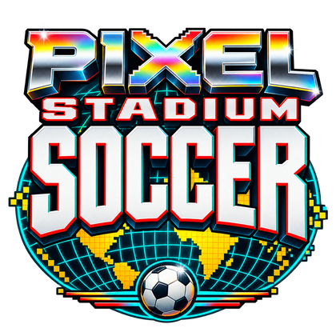</p>

# Pixel Stadium Soccer: Public Beta 1.5.87

A retro pixel football game. You play the matches yourself and run the club around them. This public beta gives you **one full season**: pick any club in any of 33 divisions, and every feature is unlocked so you can try everything.

**Install in two steps: the base game first, then the newest patch on top.**

1. **[Base game 1.5.85 (Windows, full download, 1.1 GB)](https://github.com/TristanHopkins2000/Pixel-Stadium-Beta/releases/tag/v1.5.85-beta)**: you only download this once.
2. **[Newest patch (6 MB)](https://github.com/TristanHopkins2000/Pixel-Stadium-Beta/releases/latest)**: currently 1.5.87.

Please read the [beta conditions](BETA_CONDITIONS.md) before you play.

---

## How to install

The game is installed in two steps: the **base version** (a full download) first, then any **patches** on top. A patch only works on top of its base version, so always install the base first.

### Step 1: install the base version (1.5.85)

1. Download `PixelStadiumSoccer_Beta.zip` from the [1.5.85 release](https://github.com/TristanHopkins2000/Pixel-Stadium-Beta/releases/tag/v1.5.85-beta).
2. Unzip it to a folder. Keep `PixelStadiumSoccer_Beta.exe` and `PixelStadiumSoccer_Beta.pck` together.
3. Run `PixelStadiumSoccer_Beta.exe` once to check it starts. Windows may show a SmartScreen warning because the game is not code-signed. Choose **More info → Run anyway**. The main menu shows `v1.5.85`.

### Step 2: add the newest patch on top

1. Download the patch file from the [latest release](https://github.com/TristanHopkins2000/Pixel-Stadium-Beta/releases/latest), for example `PixelStadiumSoccer_Beta_patch_1.5.87_base_1.5.85.pck`.
2. Make a folder called `patches` next to `PixelStadiumSoccer_Beta.exe` and put the patch file in it:

   ```
   PixelStadiumSoccer_Beta/
   ├── PixelStadiumSoccer_Beta.exe
   ├── PixelStadiumSoccer_Beta.pck
   └── patches/
       └── PixelStadiumSoccer_Beta_patch_1.5.87_base_1.5.85.pck
   ```
3. Start the game. The main menu now shows the new version followed by "(patch)", for example `v1.5.87 (patch)`.

Do not unzip or rename the patch, and do not put it next to the `.pck` of the base game: it must be inside `patches`.

**You need:**
- Windows 10 or 11, 64-bit
- A graphics card with Vulkan support (most cards from 2016 onwards)
- About 1.5 GB of free disk space
- A controller (recommended), or keyboard and mouse

## Updating

- **New patch out?** Download it, put it in the `patches` folder and delete the older patch file. Patches are cumulative: the newest one includes every change since the base version, so you only ever need one.
- **Already on 1.5.85?** You have the base. Just add the newest patch (step 2).
- **Still on 1.5.84?** That version cannot load patches. Install the 1.5.85 base once (step 1), then the patch. Your saves are kept, because they live in `%APPDATA%\Poly Football Stadium Edition\`, not in the game folder.
- **Patch not showing?** Check that the menu says "(patch)". If it does not, the file is in the wrong folder, renamed, or meant for a different base version (the `base_1.5.85` part of the name must match your full download). The game then simply runs the base version.
- **A new base version:** now and then a new full download replaces the base. When that happens, this page says so, and older patches stop applying.

## What's new in 1.5.87

**Loans.** Put a player on the loan list from the squad page and clubs make loan offers all through the transfer window, sometimes with an option or obligation to buy. To borrow a player, open him in the transfer search and choose *Negotiate loan*: agree the length, the share of his wage you pay, a loan fee and an option or obligation to buy with his club. They accept, counter or walk away. Recall a loanee early, or send a borrowed player back early, for a fee.

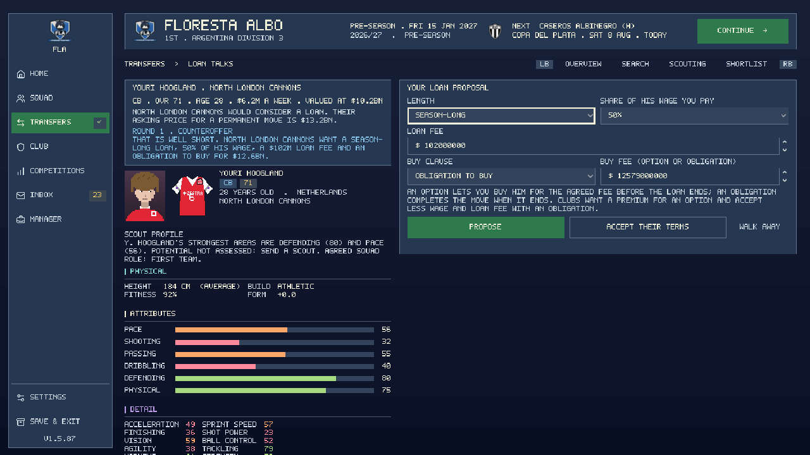

The transfer hub lists your loans, with how each loanee is doing and the recall or buy buttons.

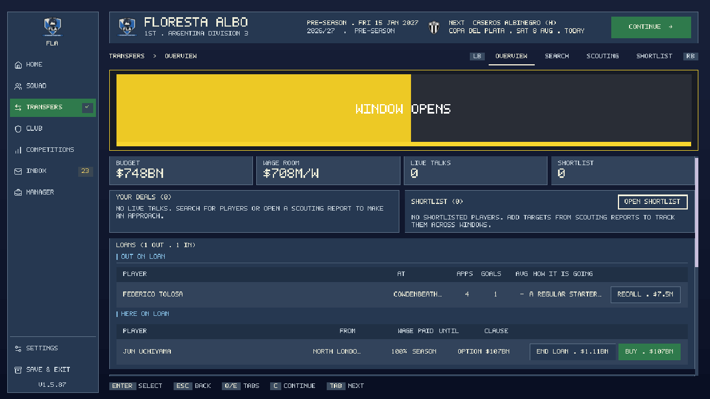

Every few rounds a loan watch in your inbox reports appearances, goals and ratings at the loan clubs.

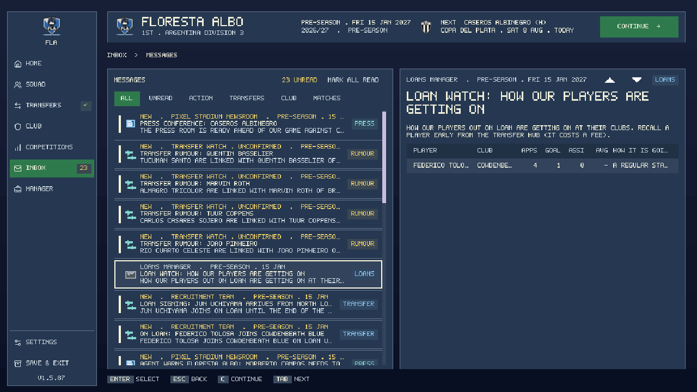

**Agents.** Agents approach you with clients who would strengthen your weakest position, and your own players' agents speak out in the press when a player is not getting a game, his contract talks stall or he is in great form.

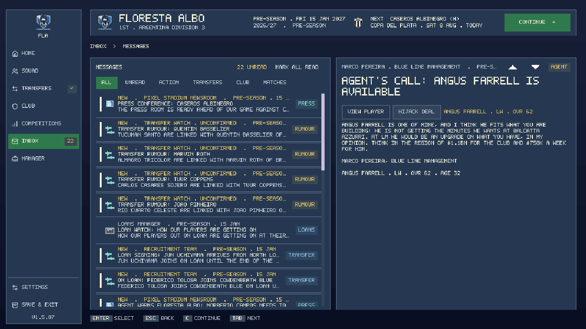

**Pyro smoke.** The dotted pixel smoke is replaced by soft, dense plumes in the club colours.

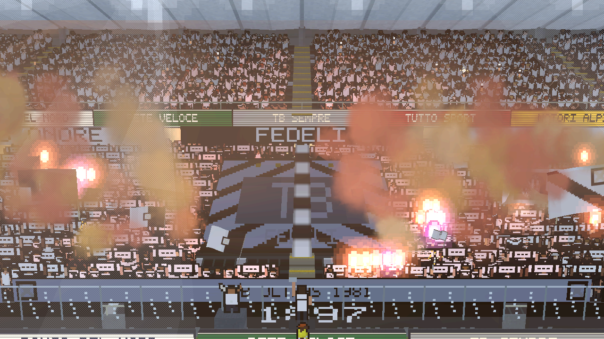

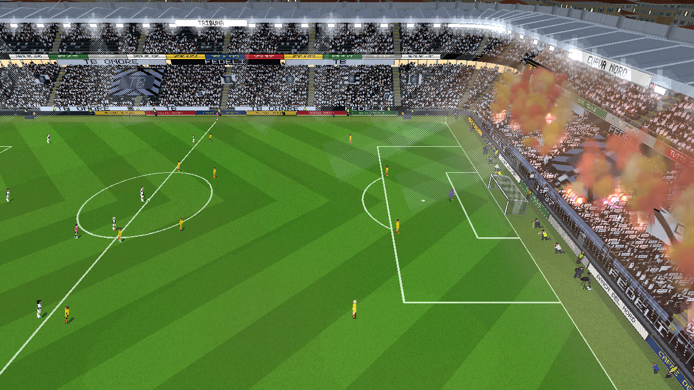

**Bookings and injuries.** Hold A / J to speed up a booking. Play stops for an injury but the ball keeps rolling, and play restarts with a dropped ball where the player went down.

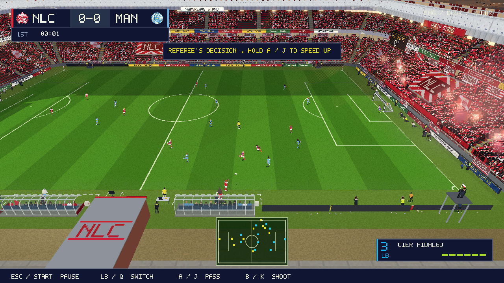

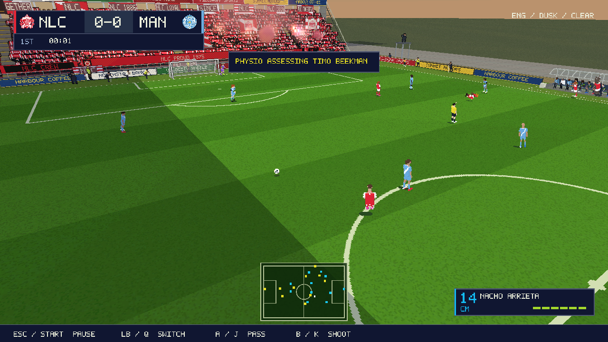

**Also:** throw-in options spread out and wait onside; free kicks by the byline stay on the pitch and the camera stays inside the ground; LB picks the player best placed for the ball and no longer switches away from a pass's receiver.

## What's in the beta

- **One season, any club.** Choose from 660 clubs in 33 divisions across 11 countries and play a full season. The beta ends with a *Beta complete* screen showing your season's stats and celebrations.
- **Everything unlocked.** Build a new stand in your first season, redesign your kits, change jobs, get sacked or resign, and try every menu.
- **Friendlies.** Quick-match friendlies use the English top-flight clubs.

## Features

### On the pitch
- Fast arcade football with planted running, close control and a classic pixel run cycle
- Six skill moves (step-over, drag-back, roulette, body feint, knock-on, flick-up) on the right stick
- Team-mates who attack the box when a winger gets forward, patient CPU build-up play and realistic keepers
- Referees with their own personalities, advantage, cards, penalties and VAR where the competition uses it
- Free kicks and penalties with aiming, throw-ins with several options to choose from, and live player ratings
- Fouls you can see: a shirt pull, a push, a trip or a tackle through the back is acted out before the whistle, and defenders who contain stand off with their arms in
- Keepers come out big in one-on-ones and slide in at your feet: chip them, slip it through their legs or hit it early
- Weather that changes the game: rain, puddles, snow, wind, fog and heat haze

### Matchday atmosphere
- 660 grounds, each built for its club, with crowds, ultras with their own banners, flags and coloured pyro that burns white-hot at the source, and smoke haze that drifts with the wind
- Teams walk out with child mascots, line up and shake hands. Every club has a costumed mascot on the touchline
- Stewards, ball kids, groundsmen, photographers with flashes, and police in each country's uniform
- When the ultras kick off, a riot squad comes out from the side of the stand. Toilet rolls and cups end up on the pitch
- Managers celebrate, sprint down the touchline for late winners and shake hands at full time
- Cup finals end on a podium with medals, the trophy lift and confetti cannons, then the fans invade the pitch

### Your club
- Full career: squad, tactics, transfers, contracts, scouting and an academy with trials, youth contracts and promotion to the first team
- Players come to you with problems and good news. Make promises and keep them, or face the consequences
- Player values rise with form and fall when players are not playing
- Board meetings with real requests, negotiated season objectives and job security
- **Stadium builder:** plan a new stand, watch the building crews work through the season, then name it or sell the naming rights
- Design your own home, away, third and goalkeeper kits
- Every country uses its own currency

### Story and media
- A newspaper that reports your actual games, in each writer's own voice
- Press conferences before matches and an optional TV interview after them. Reporters chase headlines and quote your old answers back at you
- Rival managers play mind games, fans talk about every match, and a team of the week runs each round

## Screenshots

| | |
|---|---|
|  |  |
|  |  |
|  |  |
|  |  |
|  | 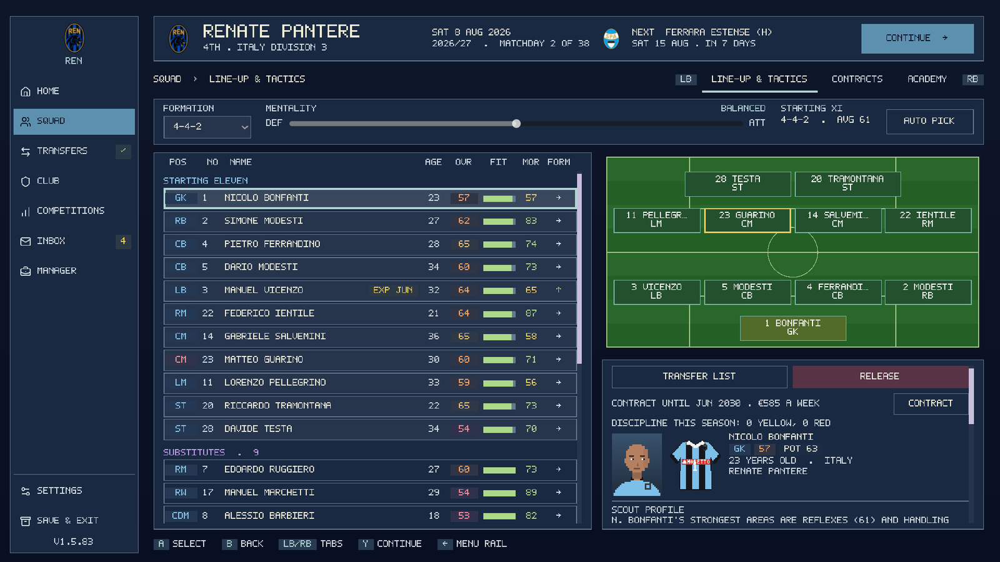 |
| 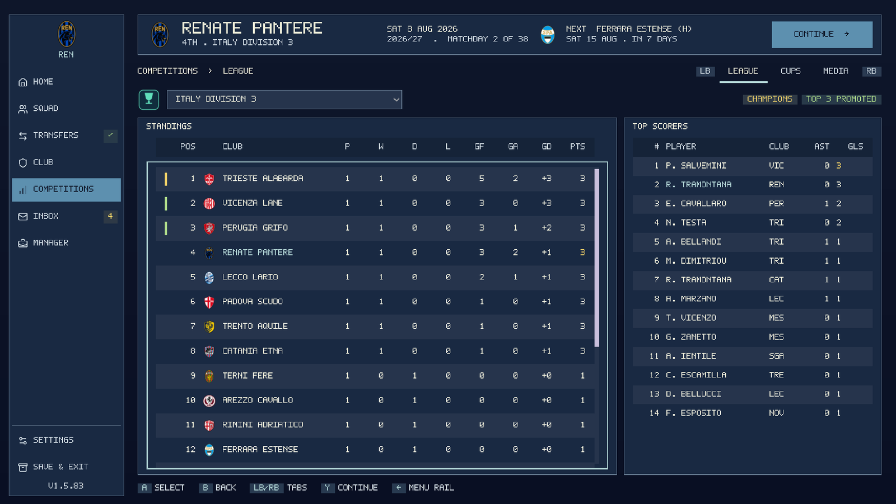 | 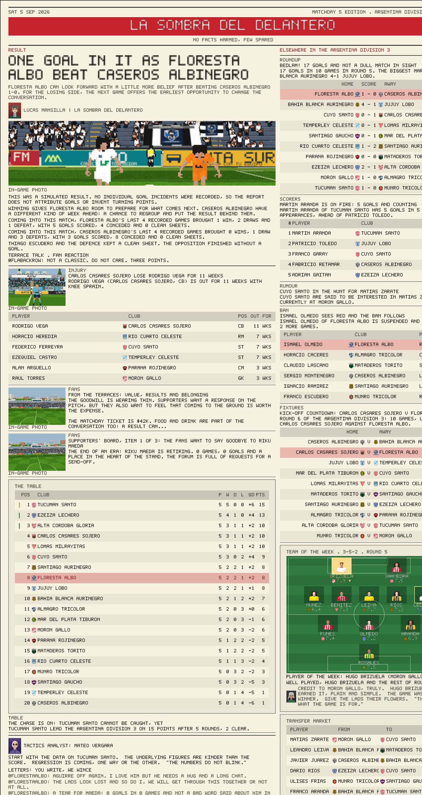 |

## Known issues

- This is a beta. Expect bugs, and save often. In testing, the game crashed once while closing; no progress was lost.
- Hair shapes show mainly in the outline of the head (ponytails and braids do not hang over the shirt).
- CPU dribblers mostly use step-overs, and only you can use the flick-up.
- Saves from this beta may not work in later versions.

## Feedback

- **Bugs and ideas:** please open an [issue](https://github.com/TristanHopkins2000/Pixel-Stadium-Beta/issues). Say what you were doing, which club you were managing, and attach a screenshot if you can.
- **In the game:** the *Beta complete* screen lets you write a note. It is saved on your PC as `beta_feedback.txt`, next to your saves in `%APPDATA%\Poly Football Stadium Edition\`, and you can attach it to an issue. The game never sends anything over the internet.

## Notes

- Every club, player, ground, competition, sponsor and broadcaster in the game is fictional. The game is not affiliated with or endorsed by any real club, league or organisation.
- Pixel Stadium Soccer is made with the [Godot Engine](https://godotengine.org). Third-party licences are listed in `THIRD_PARTY_NOTICES.txt`, which is included in the download.
- © 2026 the Pixel Stadium Soccer developer. All rights reserved. The source code is not included in this repository.
