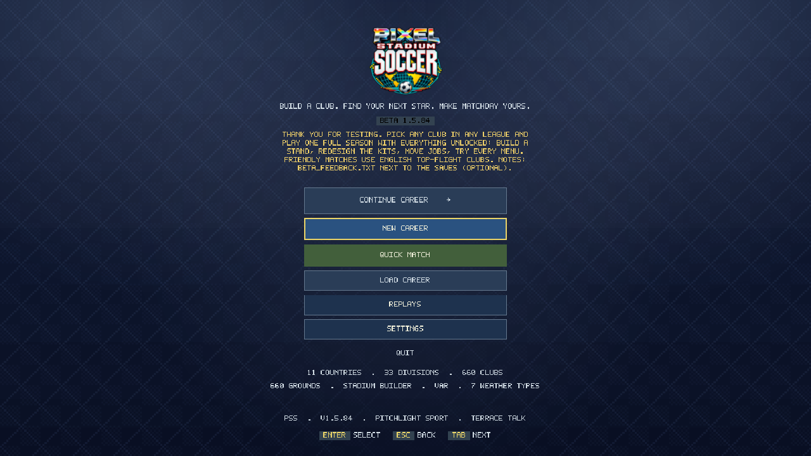
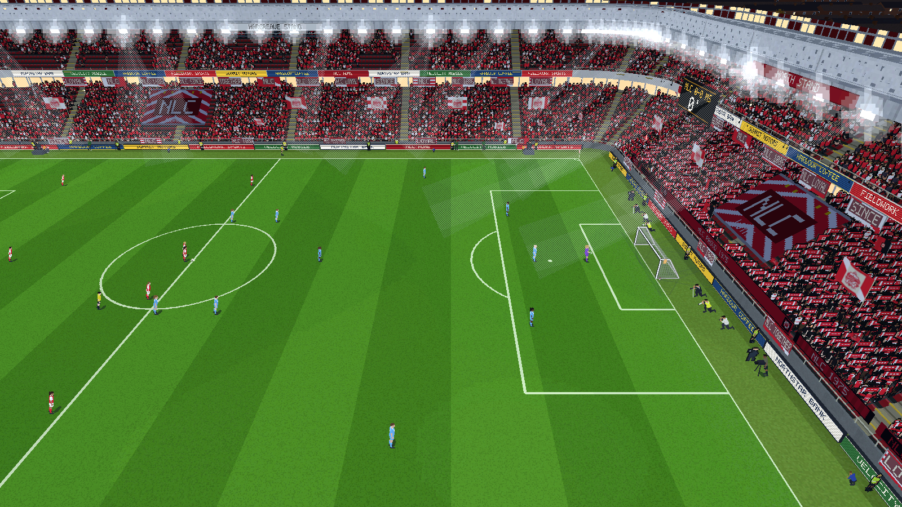
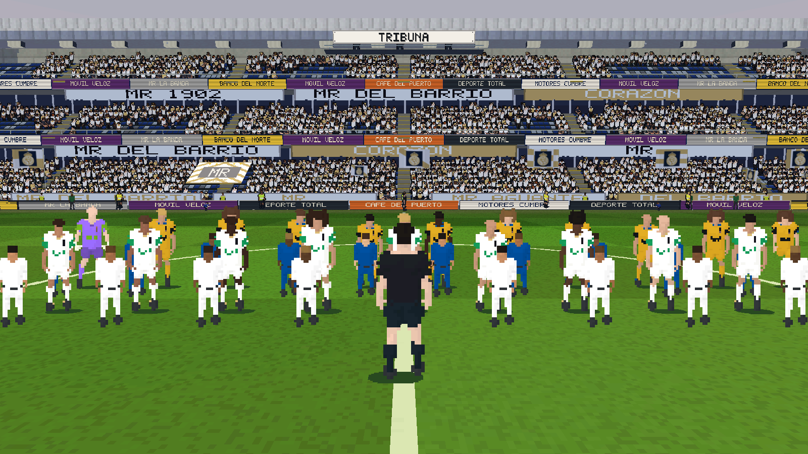
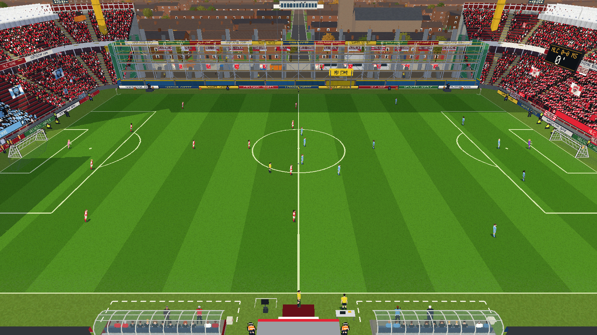
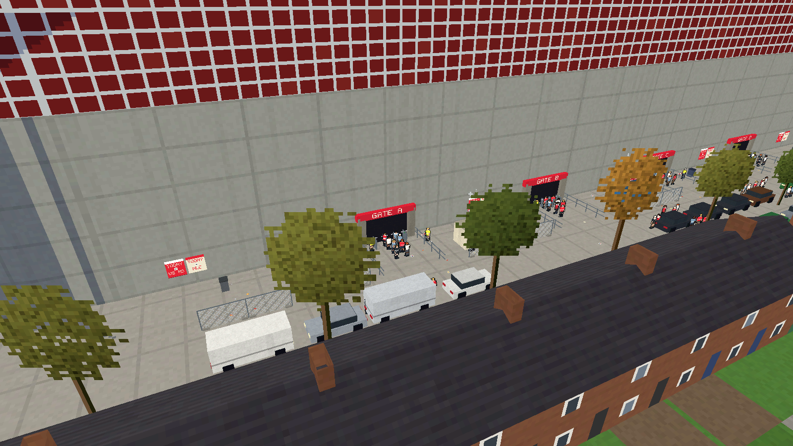
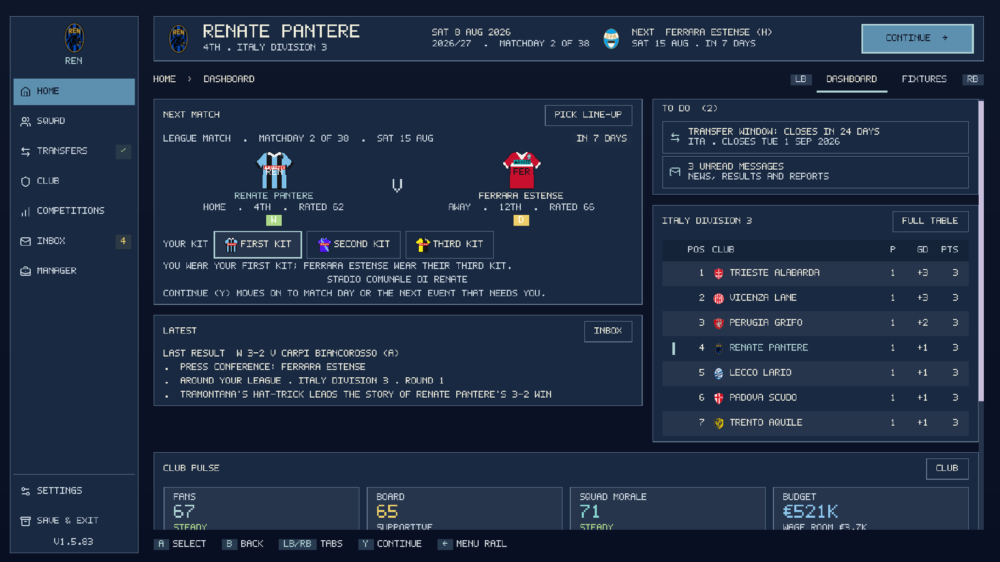

# Pixel Stadium Soccer: Public Beta 1.5.84

A retro pixel football game. You play the matches yourself and run the club around them. This public beta gives you **one full season**: pick any club in any of 33 divisions, and every feature is unlocked so you can try everything.

**[Download the beta (Windows)](https://github.com/TristanHopkins2000/Pixel-Stadium-Beta/releases/latest)**

Please read the [beta conditions](BETA_CONDITIONS.md) before you play.

---

## How to install

1. Download `PixelStadiumSoccer_Beta.zip` from the [Releases page](https://github.com/TristanHopkins2000/Pixel-Stadium-Beta/releases/latest).
2. Unzip it to a folder. Keep `PixelStadiumSoccer_Beta.exe` and `PixelStadiumSoccer_Beta.pck` together.
3. Run `PixelStadiumSoccer_Beta.exe`. Windows may show a SmartScreen warning because the game is not code-signed. Choose **More info → Run anyway**.

**You need:**
- Windows 10 or 11, 64-bit
- A graphics card with Vulkan support (most cards from 2016 onwards)
- About 1.5 GB of free disk space
- A controller (recommended), or keyboard and mouse

## What's in the beta

- **One season, any club.** Choose from 660 clubs in 33 divisions across 11 countries and play a full season. The beta ends with a *Beta complete* screen showing your season's stats and celebrations.
- **Everything unlocked.** Build a new stand in your first season, redesign your kits, change jobs, get sacked or resign, and try every menu.
- **Friendlies.** Quick-match friendlies use the English top-flight clubs.

## Features

### On the pitch
- Fast arcade football with planted running, close control and a classic pixel run cycle
- Six skill moves (step-over, drag-back, roulette, body feint, knock-on, flick-up) on the right stick
- Team-mates who attack the box when a winger gets forward, patient CPU build-up play and realistic keepers
- Referees with their own personalities, advantage, cards, penalties and VAR where the competition uses it
- Free kicks and penalties with aiming, throw-ins with several options to choose from, and live player ratings
- Weather that changes the game: rain, puddles, snow, wind, fog and heat haze

### Matchday atmosphere
- 660 grounds, each built for its club, with crowds, ultras with their own banners, flags and coloured pyro, and smoke haze that drifts with the wind
- Teams walk out with child mascots, line up and shake hands. Every club has a costumed mascot on the touchline
- Stewards, ball kids, groundsmen, photographers with flashes, and police in each country's uniform
- When the ultras kick off, a riot squad comes out from the side of the stand. Toilet rolls and cups end up on the pitch
- Managers celebrate, sprint down the touchline for late winners and shake hands at full time
- Cup finals end on a podium with medals, the trophy lift and confetti cannons, then the fans invade the pitch

### Your club
- Full career: squad, tactics, transfers, contracts, scouting and an academy with trials, youth contracts and promotion to the first team
- Players come to you with problems and good news. Make promises and keep them, or face the consequences
- Player values rise with form and fall when players are not playing
- Board meetings with real requests, negotiated season objectives and job security
- **Stadium builder:** plan a new stand, watch the building crews work through the season, then name it or sell the naming rights
- Design your own home, away, third and goalkeeper kits
- Every country uses its own currency

### Story and media
- A newspaper that reports your actual games, in each writer's own voice
- Press conferences before matches and an optional TV interview after them. Reporters chase headlines and quote your old answers back at you
- Rival managers play mind games, fans talk about every match, and a team of the week runs each round

## Screenshots

| | |
|---|---|
|  |  |
|  |  |
|  |  |
|  |  |
|  |  |
|  |  |

## Known issues

- This is a beta. Expect bugs, and save often. In testing, the game crashed once while closing; no progress was lost.
- Hair shapes show mainly in the outline of the head (ponytails and braids do not hang over the shirt).
- The smoke haze does not yet take stand roofs into account.
- CPU dribblers mostly use step-overs, and only you can use the flick-up.
- Saves from this beta may not work in later versions.

## Feedback

- **Bugs and ideas:** please open an [issue](https://github.com/TristanHopkins2000/Pixel-Stadium-Beta/issues). Say what you were doing, which club you were managing, and attach a screenshot if you can.
- **In the game:** the *Beta complete* screen lets you write a note. It is saved on your PC as `beta_feedback.txt`, next to your saves in `%APPDATA%\Poly Football Stadium Edition\`, and you can attach it to an issue. The game never sends anything over the internet.

## Notes

- Every club, player, ground, competition, sponsor and broadcaster in the game is fictional. The game is not affiliated with or endorsed by any real club, league or organisation.
- Pixel Stadium Soccer is made with the [Godot Engine](https://godotengine.org). Third-party licences are listed in `THIRD_PARTY_NOTICES.txt`, which is included in the download.
- © 2026 the Pixel Stadium Soccer developer. All rights reserved. The source code is not included in this repository.
